# Efan Ramdhani

**Mahasiswa ITS dengan fokus AI engineering.**

Saya membangun pipeline data, mengevaluasi model, dan membuat aplikasi
agar hasilnya bisa diperiksa.

## Proyek pilihan

### KANAL

Pipeline klasifikasi berita Indonesia dari RSS hingga FastAPI. Model mencapai
**macro-F1 0,420 vs 0,026 untuk baseline** pada 517 artikel uji temporal.

[Studi kasus dan demo Docker](https://github.com/Aeroo11/kanal-berita-dashboard/blob/main/docs/portfolio.md) | [Dataset publik](https://huggingface.co/datasets/aeroo11/kanal-berita)

### TokenWatch

Dashboard untuk menelusuri lonjakan biaya LLM hingga ke request yang terkait.
Simulator memakai trafik sintetis untuk membandingkan skenario routing.

[Coba demo TokenWatch](https://llm-cost-dashboard-omega.vercel.app/) | [Kode dan catatan teknis](https://github.com/Aeroo11/LLM-Cost-Dashboard)

### Faktura

Membaca invoice, mencocokkannya dengan pesanan pembelian dan bukti penerimaan
barang, lalu mengirim selisih ke antrean review. Sistem mendeteksi
**99 dari 99 anomali** pada evaluasi invoice sintetis.

[Proyek dan hasil evaluasi](https://github.com/Aeroo11/faktura/blob/main/README.id.md)

**Stack utama** Python, SQL, DuckDB, dbt, FastAPI, Next.js, dan Docker.

Proyek lain

- [Dashboard IDX](https://github.com/Aeroo11/Dashboard_IDX) untuk screening saham BEI, jurnal, dan backtest.
- [share.yow](https://github.com/Aeroo11/shareyow) untuk membagi pengeluaran bersama dan menyimpan transaksi secara offline.

Aktivitas kontribusi

[Pembaruan grafik melalui GitHub Actions](.github/workflows/kontribusi.yml)

