  

  <i>"Setiap model yang baik dimulai dari data yang jujur, dan setiap commit adalah mantra yang tertulis."</i>

---

### 🪄 Lumos: siapa saya

Mahasiswa **Institut Teknologi Sepuluh Nopember (ITS)** yang sedang menempa diri menjadi **AI Engineer**.
Saya suka membangun sistem yang **mengukur dirinya sendiri secara jujur**, dari pipeline data, klasifikasi teks, sampai observabilitas biaya LLM.

- 🔮 **Sedang meracik:** aplikasi LLM (RAG, agen, evaluasi), MLOps, dan *model lifecycle*
- 📊 **Ramuan andalan:** data pipeline dengan DuckDB + dbt, dashboard analitik, aplikasi offline-first
- 🧪 **Prinsip lab:** angka terukur lebih penting daripada klaim, termasuk saat hasilnya buruk

### 📜 Buku mantra

  

| Aliran sihir | Mantra yang dikuasai |
|---|---|
| 🤖 AI & ML | Python, scikit-learn, klasifikasi teks, evaluasi model, LLM API |
| 🗄️ Data | DuckDB, dbt, pandas, Plotly, seaborn, Selenium, BeautifulSoup |
| 🌐 Web & Mobile | Next.js, React Native (Expo), Flask, FastAPI |
| ⚙️ Ops | Docker, GitHub Actions, Git |

### 🏰 Karya unggulan

| | Proyek | Sihirnya |
|:-:|---|---|
| 🔥 | [**TokenWatch**](https://github.com/Aeroo11/LLM-Cost-Dashboard) | Observabilitas biaya LLM: ingest → transformasi SQL → streaming SSE, plus deteksi insiden statistik.  Next.js · TypeScript · DuckDB |
| 📰 | [**KANAL**](https://github.com/Aeroo11/kanal-berita-dashboard) | *Model lifecycle* untuk klasifikasi berita Indonesia: ingestion 25 RSS feed tiap jam, dbt + data contracts, dataset publik di Hugging Face.  Python · DuckDB · dbt · Docker |
| 📈 | [**Dashboard IDX**](https://github.com/Aeroo11/Dashboard_IDX) | Analisis saham BEI & XAUUSD yang melaporkan ekspektasi terukur aturannya sendiri.  Python · GitHub Actions |
| 💸 | [**share.yow**](https://github.com/Aeroo11/shareyow) | Patungan anak kos yang tetap jalan tanpa sinyal.  React Native · Expo · TypeScript · SQLite |

### 🗺️ Peta jejak sihir

  

Digambar ulang setiap hari dari data kontribusi GitHub oleh <a href=".github/workflows/peta-jejak-sihir.yml">GitHub Actions</a>.

---

✨ <i>Nox.</i> Terima kasih sudah mampir. ✨

