  

  <i>"All models are wrong, but some are useful."</i> 
  — George E. P. Box, statistikawan

---

### 👋 Tentang Saya

Mahasiswa **Institut Teknologi Sepuluh Nopember (ITS)** yang berfokus menjadi **AI Engineer**.
Saya membangun sistem data dan machine learning dari ujung ke ujung: pengumpulan data, pipeline, pemodelan, hingga dashboard untuk memantau hasilnya.

- 🔭 **Fokus saat ini:** aplikasi LLM (RAG, agent, evaluasi model) dan MLOps
- 🛠️ **Keahlian utama:** data pipeline dengan DuckDB dan dbt, klasifikasi teks, dashboard analitik
- 📏 **Prinsip kerja:** setiap keputusan didukung metrik yang terukur dan dapat diverifikasi

### 🧰 Tech Stack

  

| Bidang | Teknologi |
|---|---|
| 🤖 AI & Machine Learning | Python, scikit-learn, klasifikasi teks, evaluasi model, LLM API |
| 🗄️ Data Engineering | DuckDB, dbt, pandas, Plotly, seaborn, Selenium, BeautifulSoup |
| 🌐 Web & Mobile | Next.js, React Native (Expo), Flask, FastAPI |
| ⚙️ DevOps | Docker, GitHub Actions, Git, Linux |

### 🚀 Proyek Unggulan

| | Proyek | Deskripsi |
|:-:|---|---|
| 🔥 | [**TokenWatch**](https://github.com/Aeroo11/LLM-Cost-Dashboard) | Dashboard observabilitas biaya LLM: ingestion → transformasi SQL → streaming SSE, dilengkapi deteksi insiden secara statistik.  Next.js · TypeScript · DuckDB |
| 📰 | [**KANAL**](https://github.com/Aeroo11/kanal-berita-dashboard) | Platform *model lifecycle* untuk klasifikasi berita Indonesia: ingestion 25 RSS feed tiap jam, dbt dengan data contracts, dan dataset publik di Hugging Face.  Python · DuckDB · dbt · Docker |
| 📈 | [**Dashboard IDX**](https://github.com/Aeroo11/Dashboard_IDX) | Dashboard analisis saham BEI & XAUUSD dengan screening, position sizing, dan backtest yang melaporkan kinerja strateginya secara transparan.  Python · GitHub Actions |
| 💸 | [**share.yow**](https://github.com/Aeroo11/shareyow) | Aplikasi mobile *offline-first* untuk mencatat dan menyelesaikan pengeluaran bersama.  React Native · Expo · TypeScript · SQLite |

### 📊 Aktivitas Kontribusi

  

Diperbarui otomatis setiap hari melalui <a href=".github/workflows/kontribusi.yml">GitHub Actions</a>.

---

Terima kasih sudah berkunjung. Terbuka untuk diskusi dan kolaborasi di bidang data &amp; AI.

